# LAPORAN PRAKTIKUM 9

## PEMROGRAMAN WEB

**Nama** : Aidi Syahdan Firdaus  
**Nim** : 312510089  
**Kelas** : I251A  

## Persiapan praktikum :

Nyalakan apache dan mysql di xampp

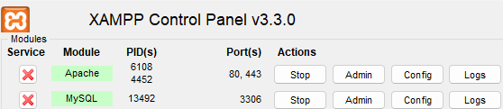

Buat folder di xampp/htdocs

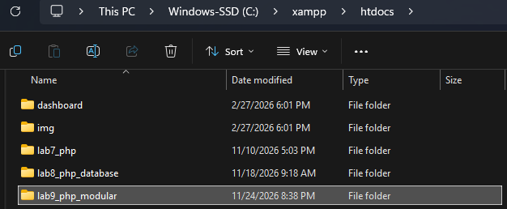

## Include dan require :

Buat file pesan.php dan uji-include-require

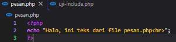

Panggil menggunakan include

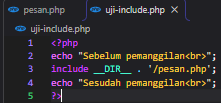

Hasil di browser :

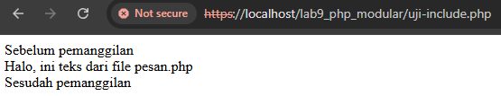

Ubah nama pesan.php semantara, lalu amati error

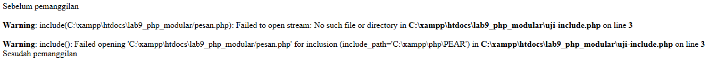

Ulangi percobaan menggunakan require

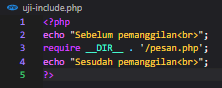

Hasilnya

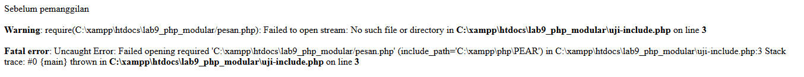

Kembalikan nama filenya menjadi pesan.php

## Kesimpulan yang saya dapat :

Saat file yang dipanggil tidak ditemukan, include hanya memunculkan Warning dan tetap menjalankan baris kode setelahnya, sedangkan require langsung menghasilkan Fatal error dan menghentikan eksekusi program.

## Membuat template layout dengan php :

Buat header.php

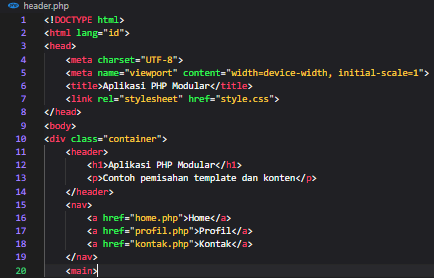

Buat footer.php

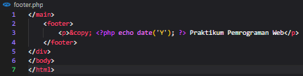

Buat home.php

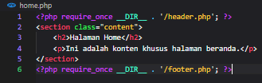

Buat about.php

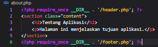

Buat kontak.php

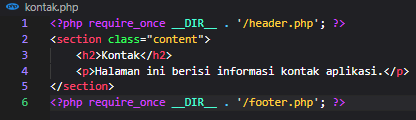

Buat style.css

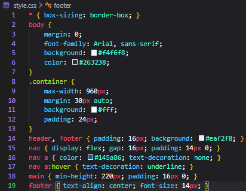

Hasil di browser

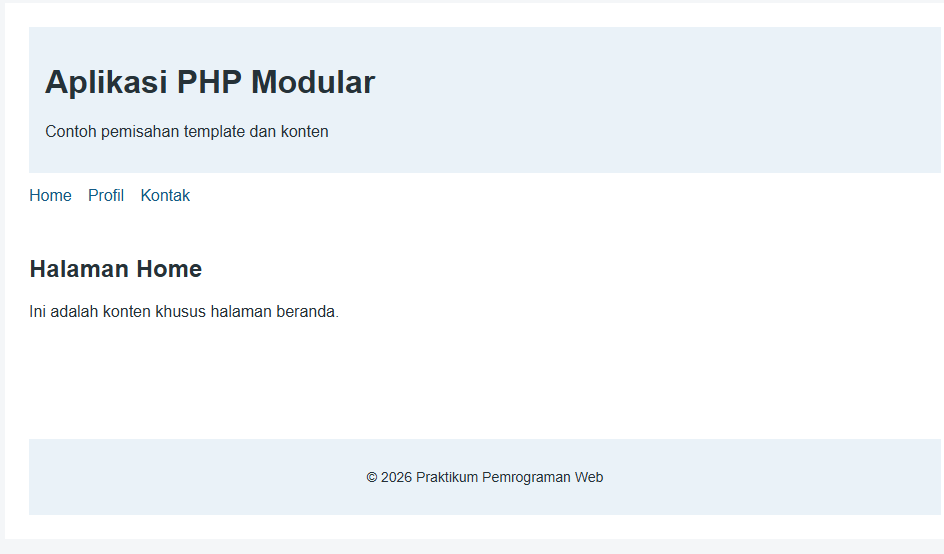

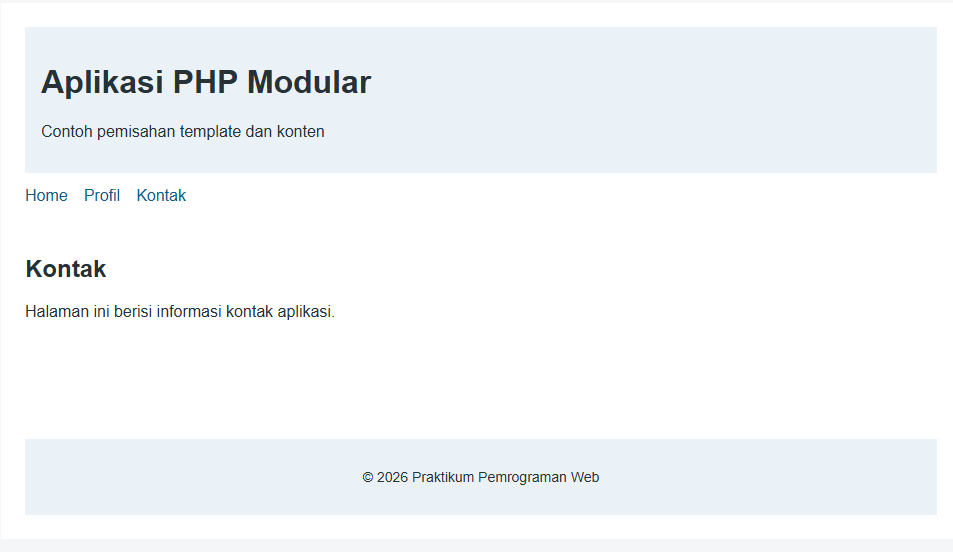

## Analisis hasil :

**Bagian mana yang digunakan bersama oleh semua halaman?** Bagian yang digunakan bersama oleh semua halaman adalah kerangka antarmuka pada header.php (awal dokumen HTML, judul, dan navigasi), footer.php (penutup halaman), serta style.css.

**Apa yang terjadi jika teks navigasi diubah pada header.php?** Teks navigasi pada seluruh halaman yang memanggil header.php akan otomatis ikut berubah tanpa perlu mengedit setiap file halaman satu per satu.

**Mengapa konten halaman tidak diletakkan seluruhnya di header.php?** Karena setiap halaman memiliki isi konten khusus yang berbeda-beda, sedangkan template header.php hanya menyimpan bagian antarmuka awal yang digunakan bersama.

**Apa manfaat menggunakan require_once dibanding menyalin kode header ke setiap halaman?** Penggunaan require_once mencegah penulisan kode berulang, memastikan file template wajib hanya dimuat satu kali, serta mempermudah pemeliharaan saat ada perubahan tampilan.

## Function pada PHP :

Function tanpa parameter

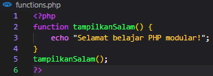

Function dengan parameter

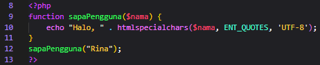

Function dengan return

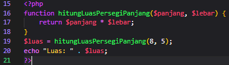

Type declaration dan nilai default

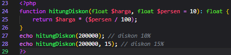

Memisahkan function ke file helper

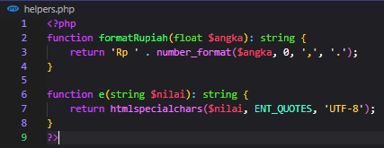

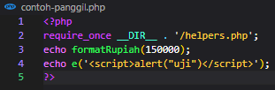

## Latihan :

buat function konversi celcius ke farenheit

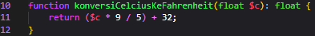

Buat function tentukan status nilai

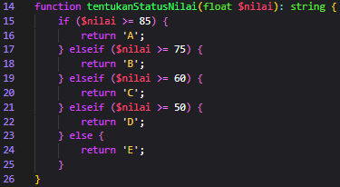

Buat function hitung total

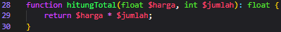

Pindahkan seluruh function ke file helpers.php dan panggil dari minimal dua halaman berbeda

Semua function sudah di buat dalam helper

Ubah home.php

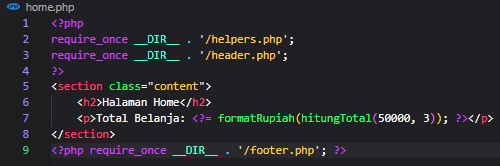

Ubah about.php

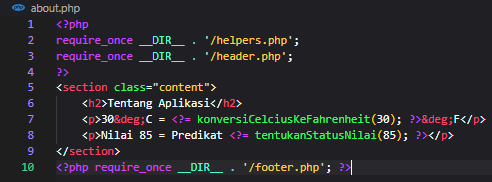

Halaman about

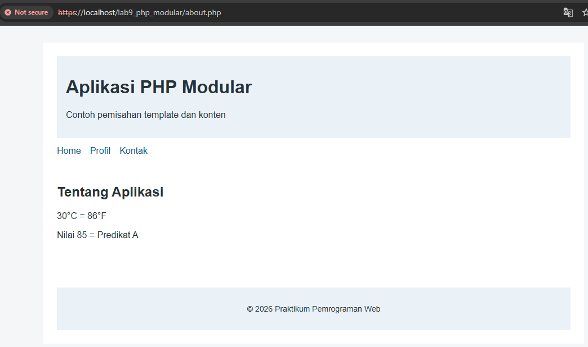

Halaman home

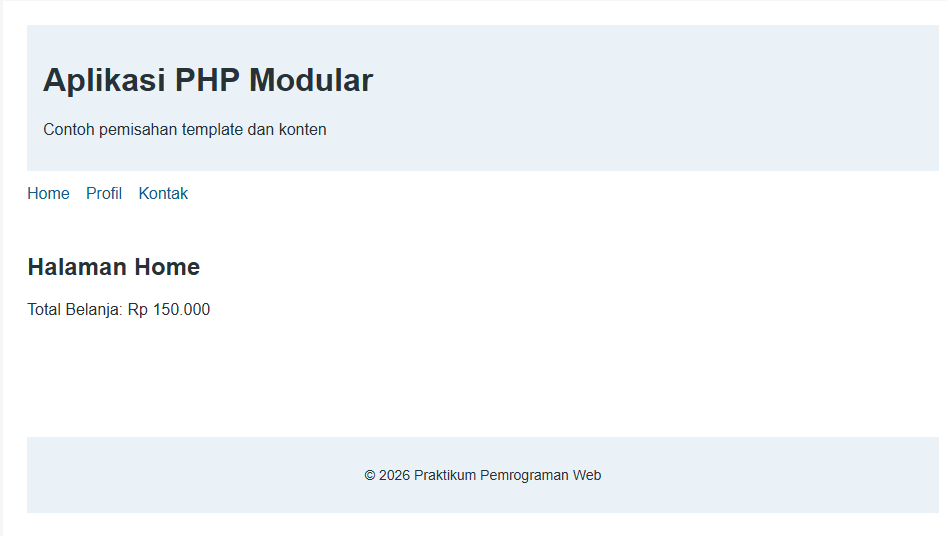

Buat folder project dan susun struktur seperti di modul

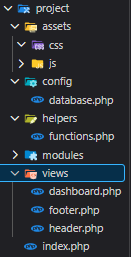

## Routing sederhana dengan parameter URL

Isi header.php di folder project, untuk footer pakai yang sebelumnya

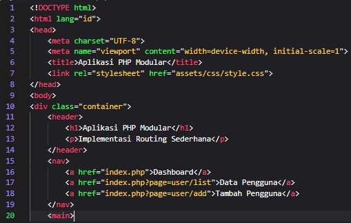

Isi dashboard.php

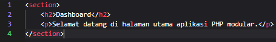

Isi index.php

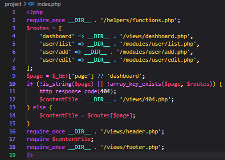

Isi list.php

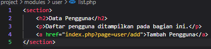

Isi add.pho

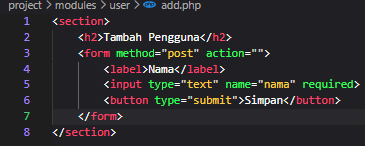

Buat file 404.php

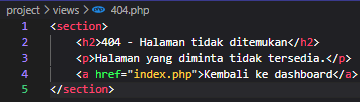

Hasil di browser :

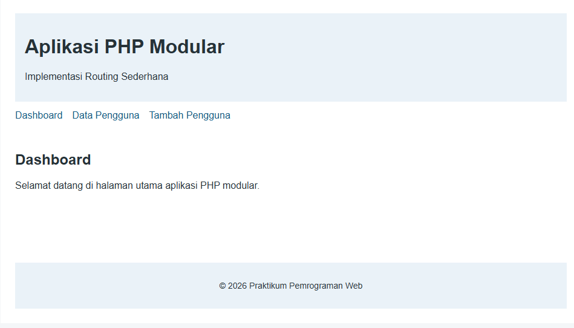

Bagian data pengguna

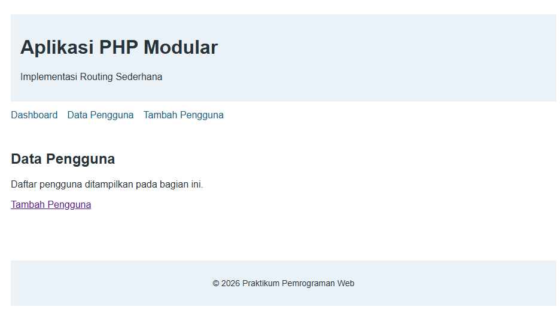

Bagian tambah pengguna

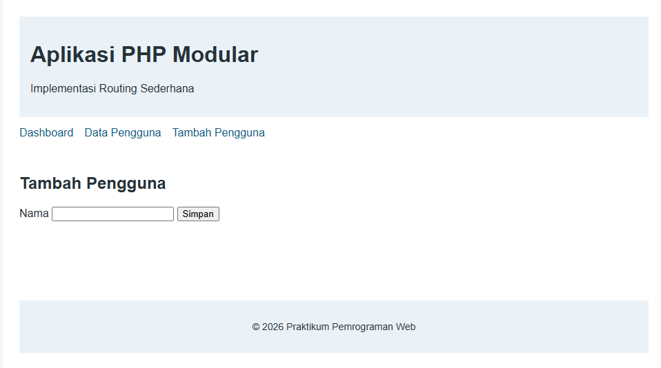

Parameter page yang tidak terdaftar

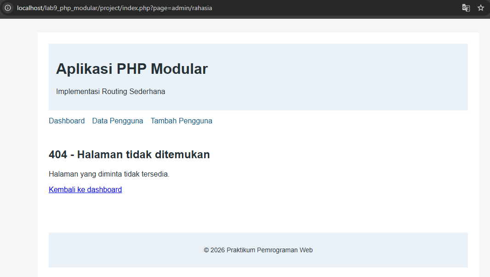

Parameter page kosong

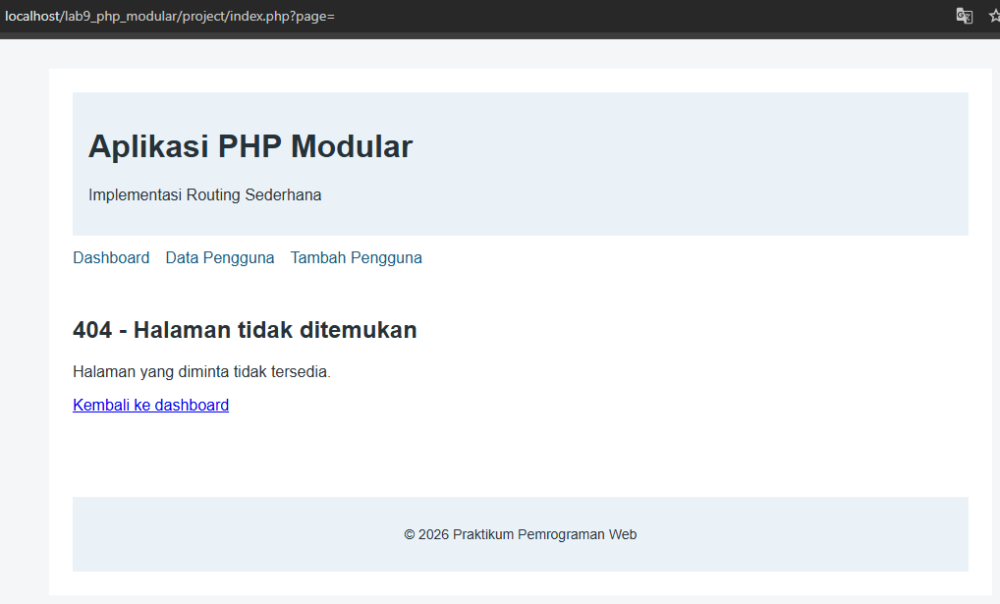

## Integrasi aplikasi database project sebelumnya:

Salin folder project sebelumnya ke dalam folder project sekarang

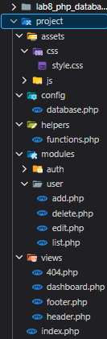

Isi database.php

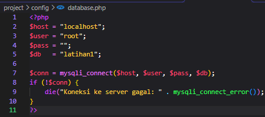

Tambahkan fungsi is_select() dari ubah.php lama ke dalam file helper agar bisa dipakai ulang untuk form pilihan kategor

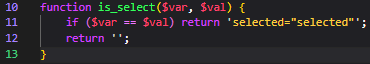

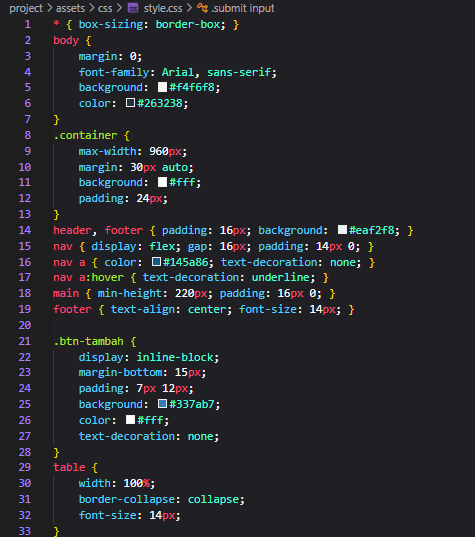

Gabungkan CSS layout dari Modul 9 dengan CSS tabel dan form dari lab8 php database/style.css

Ubah heder.php agar navigasinya sesuai

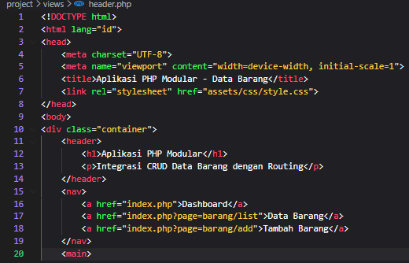

Ubah nama folder users ke barang

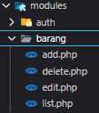

Ubah list.php

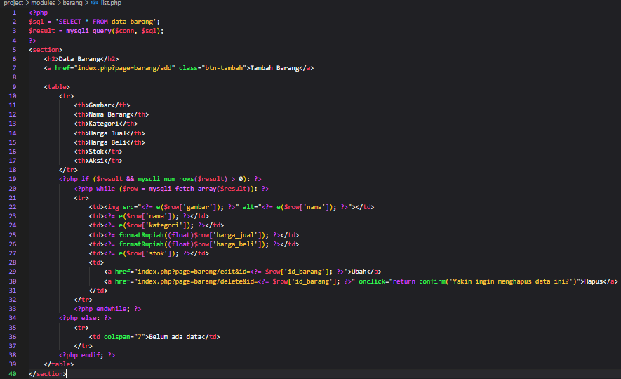

Ubah add.php

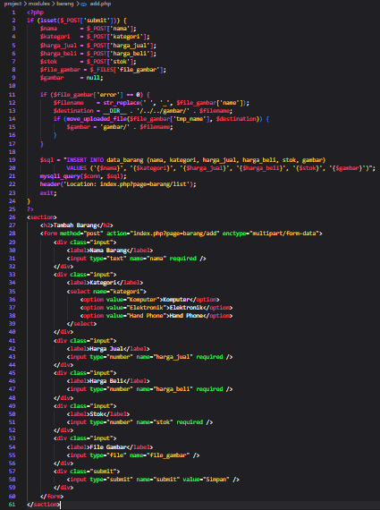

Isi edit.php

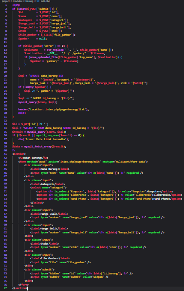

Isi hapus.php

Lalu ubah index.php sebagai router utama

Hasil di browser

Uji tambah barang

## Pertanyaan pemahaman

1. **Jelaskan pengertian modularisasi program dan minimal tiga manfaatnya.** Modularisasi program adalah teknik memecah kode aplikasi menjadi bagian-bagian kecil yang terpisah berdasarkan fungsi dan tanggung jawabnya masing-masing. Tiga manfaat utamanya adalah mencegah penulisan kode yang berulang, mempermudah pemeliharaan serta penelusuran kode saat aplikasi berkembang, dan meminimalkan konflik pengerjaan dalam tim.

2. **Apa perbedaan include dan require ketika file yang dipanggil tidak ditemukan?** Ketika file tidak ditemukan, include hanya menghasilkan pesan peringatan (Warning) dan tetap melanjutkan eksekusi baris kode berikutnya, sedangkan require langsung memunculkan Fatal error dan menghentikan eksekusi program pada baris tersebut.

3. **Mengapa require_once sesuai digunakan untuk memuat konfigurasi database?** Karena file konfigurasi database bersifat wajib agar aplikasi dapat berjalan, dan penggunaan require_once menjamin file tersebut hanya dimuat satu kali sehingga tidak terjadi pendeklarasian ulang yang memicu error.

4. **Jelaskan perbedaan parameter, argumen, dan nilai return pada function.** Parameter adalah variabel yang didefinisikan pada deklarasi function, argumen adalah nilai nyata yang dikirimkan saat function dipanggil, sedangkan nilai return adalah hasil akhir yang dikembalikan oleh function kepada pemanggilnya agar dapat disimpan atau diolah kembali.

5. **Mengapa header dan footer sebaiknya dipisahkan dari konten halaman?** Agar komponen antarmuka yang seragam di seluruh halaman tidak perlu ditulis ulang secara berulang-ulang, sehingga perubahan desain atau navigasi cukup dilakukan pada satu file template saja.

6. **Apa fungsi index.php pada pola routing yang dipraktikkan?** index.php berperan sebagai pintu masuk tunggal (entry point) dan pengatur rute (router) yang membaca parameter URL, memuat konfigurasi serta template bersama, lalu memanggil file modul halaman yang sesuai.

7. **Mengapa router sebaiknya menggunakan whitelist rute?** Untuk membatasi akses hanya pada daftar halaman yang telah ditentukan dan diizinkan oleh aplikasi, sekaligus mengarahkan permintaan halaman yang tidak dikenal ke halaman 404 secara aman.

8. **Apa risiko jika input page langsung digabungkan menjadi path file yang di-require?** Aplikasi menjadi rentan terhadap celah keamanan path traversal maupun pemanggilan file internal yang tidak semestinya diakses oleh pengguna melalui manipulasi parameter URL.

9. **Apa fungsi aturan RewriteCond dan RewriteRule pada .htaccess?** RewriteCond memeriksa kondisi apakah URL yang diminta bukan merupakan file atau direktori fisik yang tersedia di server, sedangkan RewriteRule meneruskan permintaan URL ringkas tersebut ke index.php?page=... agar diproses oleh router.

10. **Sebutkan bagian aplikasi CRUD yang paling tepat dipindahkan ke config, views, helpers, dan modules.** Pengaturan koneksi database dipindahkan ke config, komponen tampilan bersama seperti header, footer, dashboard, dan halaman 404 ke views, fungsi bantuan umum seperti format mata uang atau validasi ke helpers, serta seluruh file fitur utama CRUD (tampil, tambah, ubah, hapus data) ke modules.
